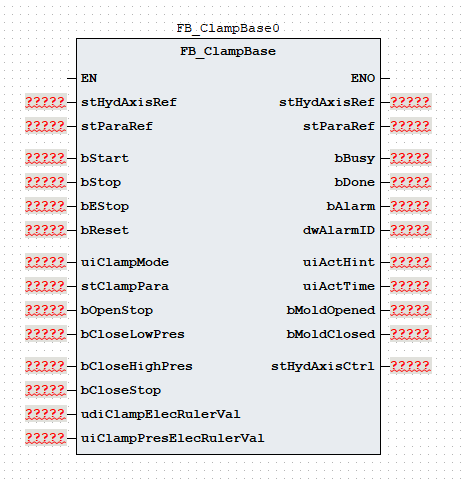
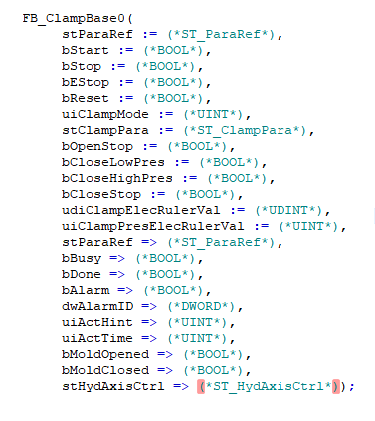

# 《FB_ClampBase 功能块使用说明》

| 项目 | 内容 |
|---|---|
| 模块名称 | `FB_ClampBase` |
| 适用场景 | 注塑机锁模机构的开模、合模、低压保护和高压锁模控制 |  
| 版本信息 | 文档版本 1.1；库版本  `PlasticLibs` 1.0.26.908；更新日期 2026-09-10 |
| 依赖库信息 | `HydTechnology` 0.1.1.0，提供 `FB_HydAxis`、`ST_HydAxisRef` 等液压轴相关类型和功能块|
| 事实原则 | 以下描述以当前 ST 执行逻辑为准；注释与实际逻辑不一致时标注“需协议确认” |

## 1. 功能概述

### 功能职责

`FB_ClampBase` 将锁模工艺参数和开/合模反馈转换为分阶段轴命令、动作状态和报警结果，并交给内部轴功能块执行。功能块支持：

- 开模最多 5 段，开模前可执行卸荷；
- 合模最多 4 段，合模后依次执行低压和高压阶段；
- 开模调模、合模调模两种调模模式；
- 电子尺位置、数字停止信号、时间和压力等结束条件；
- 开模完成、合模完成、动作提示、报警状态和报警代码输出。

### 输入与输出

| 调用者提供 | 功能块输出 |
|---|---|
| `bStart`、`bStop`、`bEStop`、`bReset`、`uiClampMode` | `bBusy`、`bDone`、`bAlarm`、`dwAlarmID` |
| `stClampPara`、`stParaRef` | `uiActHint`、`uiActTime`、`bMoldOpened`、`bMoldClosed` |
| `stHydAxisRef`、开模/合模停止信号、电子尺位置和压力反馈 | `stHydAxisCtrl` 轴命令和轴状态包；`stHydAxisRef` 回写轴状态 |

### 主要流程

~~~text
读取模式并确定开模/合模方向及调模标志
  -> 按优先级处理复位、急停和停止
  -> Idle 检测 bStart 上升沿后进入 Init
  -> 常规开模：OpenUnloadPres -> Opening[0..4] -> Opened
  -> 模保后开模：Init -> Opening[0..4] -> Opened -> Error
  -> 合模：Closing[0..3] -> CloseLowPres -> CloseHighPres -> Closed
  -> 合模总限时/低压保护触发：置报警位并调用 CheckMoldProtectOpen
  -> `uiMoldProtectOpen=0` 时进入 Error；非 `0` 时 Init -> Opening -> Opened -> Error
  -> 急停、无效模式或开模限时 -> Error
  -> 内部调用 FB_HydAxis，回写 stHydAxisRef 并转存轴命令和轴状态到 stHydAxisCtrl
~~~

### 功能边界

本功能块生成工艺阶段和轴命令，并在当前 ST 的固定分支中直接调用 `FB_HydAxis`，不访问通信报文、全局变量、`%I/%Q` 或物理 I/O；独立急停、安全继电器、限位保护和机械能量切断仍不由本功能块提供。`FB_EleAxis` 分支虽然保留在 ST 中，但当前 `IF TRUE` 条件下不会执行；电动轴切换需先修改并核对实际 POU 实现。

## 2. 自定义数据类型

### 2.1 `E_ClampState`

| 枚举成员 | 用途 |
|---|---|
| `eClampState_Idle` | 空闲 |
| `eClampState_Init` | 初始化 |
| `eClampState_OpenUnloadPres` | 开模卸荷 |
| `eClampState_Opening` | 开模 |
| `eClampState_Opened` | 开模完成 |
| `eClampState_Closing` | 合模 |
| `eClampState_CloseLowPres` | 合模低压 |
| `eClampState_CloseHighPres` | 合模高压 |
| `eClampState_Closed` | 合模完成 |
| `eClampState_Error` | 错误 |

### 2.2 `ST_ClampSeg`

| 成员 | 类型 | 读写属性 | 用途 |
|---|---|---|---|
| `uiPres` | `UINT` | 只读 | 压力命令 |
| `uiSpd` | `UINT` | 只读 | 速度命令 |
| `udiPos` | `UDINT` | 只读 | 位置目标 |
| `uiTime` | `UINT` | 只读 | 时间阈值 |
| `uiPresGrad` | `UINT` | 只读 | 压力斜率 |
| `uiSpdGrad` | `UINT` | 只读 | 速度斜率 |

### 2.3 `ST_ClampPara`

| 成员 | 类型 | 读写属性 | 用途 |
|---|---|---|---|
| `uiMoldProtectOpen` | `UINT` | 只读 | 模保后开模功能：`0` 使用，`1` 不用 |
| `uiOpenSegCnt` | `UINT` | 只读 | 开模段数；收口到 `0..4` |
| `uiOpenMode` | `UINT` | 只读 | 开模方式：`0` 行程，`1` 位置 |
| `uiOpenLimitTime` | `UINT` | 只读 | 开模动作总时限 |
| `stOpenUnloadPres` | `ST_ClampSeg` | 只读 | 开模卸荷参数 |
| `aOpenSeg` | `ARRAY[0..4] OF ST_ClampSeg` | 只读 | 开模分段参数 |
| `stOpenDebug` | `ST_ClampSeg` | 只读 | 开模调模参数 |
| `uiOpenDebugPresStartGrad` | `UINT` | 只读 | 开模调模压力启动斜率 |
| `uiOpenDebugPresStopGrad` | `UINT` | 只读 | 开模调模压力停止斜率 |
| `uiOpenDebugSpdStartGrad` | `UINT` | 只读 | 开模调模速度启动斜率 |
| `uiOpenDebugSpdStopGrad` | `UINT` | 只读 | 开模调模速度停止斜率 |
| `uiOpenPresStartGrad` | `UINT` | 只读 | 开模压力启动斜率 |
| `uiOpenPresStopGrad` | `UINT` | 只读 | 开模压力停止斜率 |
| `uiOpenSpdStartGrad` | `UINT` | 只读 | 开模速度启动斜率 |
| `uiOpenSpdStopGrad` | `UINT` | 只读 | 开模速度停止斜率 |
| `uiCloseSegCnt` | `UINT` | 只读 | 合模段数；收口到 `0..3` |
| `uiCloseMode` | `UINT` | 只读 | 合模方式：`0` 行程，`1` 位置  |
| `uiCloseLimitTime` | `UINT` | 只读 | 合模动作总时限 |
| `uiCloseLowPresLimitTime` | `UINT` | 只读 | 低压阶段保护时间阈值 |
| `uiCloseEndMode` | `UINT` | 只读 | 高压终止方式：`0` 时间、`1` 行程、`2` 压力 |
| `uiCloseEndHighPres` | `UINT` | 只读 | 高压压力结束偏差 |
| `aCloseSeg` | `ARRAY[0..3] OF ST_ClampSeg` | 只读 | 合模分段参数 |
| `stCloseLowPres` | `ST_ClampSeg` | 只读 | 合模低压参数 |
| `stCloseHighPres` | `ST_ClampSeg` | 只读 | 合模高压参数 |
| `stCloseDebug` | `ST_ClampSeg` | 只读 | 合模调模参数 |
| `uiCloseDebugPresStartGrad` | `UINT` | 只读 | 合模调模压力启动斜率 |
| `uiCloseDebugPresStopGrad` | `UINT` | 只读 | 合模调模压力停止斜率 |
| `uiCloseDebugSpdStartGrad` | `UINT` | 只读 | 合模调模速度启动斜率 |
| `uiCloseDebugSpdStopGrad` | `UINT` | 只读 | 合模调模速度停止斜率 |
| `uiClosePresStartGrad` | `UINT` | 只读 | 合模压力启动斜率 |
| `uiClosePresStopGrad` | `UINT` | 只读 | 合模压力停止斜率 |
| `uiCloseSpdStartGrad` | `UINT` | 只读 | 合模速度启动斜率 |
| `uiCloseSpdStopGrad` | `UINT` | 只读 | 合模速度停止斜率 |

### 2.4 `ST_ParaRef`

| 成员 | 类型 | 读写属性 | 用途 |
|---|---|---|---|
| `udiPosToleranceValue` | `UDINT` | 读写 | 位置容差值 |

### 2.5 `ST_HydAxisRef`

该类型由液压轴库定义。`FB_ClampBase` 将其传入内部 `FB_HydAxis`，调用后再回写；结构成员请查阅 HydTechnology 技术库使用说明书。

### 2.6 `ST_HydAxisCtrl`

| 成员 | 类型 | 读写属性 | 用途 |
|---|---|---|---|
| `bAxisStart` | `BOOL` | 只写 | 轴启动信号 |
| `uiAxisDir` | `UINT` | 只写 | 轴方向值；开模写 `1`、合模写 `2` |
| `uiAxisMode` | `UINT` | 只写 | 轴命令模式：`1` 位置、`2` 速度、`3` 压力 |
| `uiPresCmd` | `UINT` | 只写 | 压力命令 |
| `uiSpdCmd` | `UINT` | 只写 | 速度命令 |
| `uiEndSpdCmd` | `UINT` | 只写 | 段结束速度 |
| `udiPosCmd` | `UDINT` | 只写 | 位置命令 |
| `uiAxisPresAcc` | `UINT` | 只转存 | 压力加速度参数 |
| `uiAxisPresDec` | `UINT` | 只转存 | 压力减速度参数 | 
| `uiAxisSpdAcc` | `UINT` | 只写 | 速度加速度参数 |
| `uiAxisSpdDec` | `UINT` | 只写 | 速度减速度参数 |
| `uiAxisJerk` | `UINT` | 只写 | 加加速度参数 |
| `bBusy` | `BOOL` | 内部轴功能块写入 | 液压轴忙状态 |
| `bDone` | `BOOL` | 内部轴功能块写入 | 液压轴完成状态 |
| `bInVelocity` | `BOOL` | 内部轴功能块写入 | 液压轴速度到位状态 |
| `bInPressure` | `BOOL` | 内部轴功能块写入 | 液压轴压力到位状态 |
| `bAlarm` | `BOOL` | 内部轴功能块写入 | 液压轴报警状态 |
| `dwAlarmID` | `DWORD` | 内部轴功能块写入 | 液压轴报警代码 |

## 3. 功能块接口

### 3.1 `VAR_IN_OUT`

| 名称 | 类型 | 当前行为 | 信号含义 |
|---|---|---|---|
| `stHydAxisRef` | `ST_HydAxisRef` | 传入内部 `FB_HydAxis`，调用后回写 | 液压轴参数引用 |
| `stParaRef` | `ST_ParaRef` | 引用位置容差值 | 工艺参数引用 |

### 3.2 `VAR_INPUT`

| 名称 | 类型 | 当前行为 | 信号含义 |
|---|---|---|---|
| `bStart` | `BOOL` | 在 `Idle` 状态检测上升沿后启动初始化，下降沿也会进入停止分支 | 启动命令 |
| `bStop` | `BOOL` | 优先级低于复位和急停；回到空闲并清主要轴命令 | 正常停止 |
| `bEStop` | `BOOL` | 进入错误状态并置 `16#0001` | 急停请求 |
| `bReset` | `BOOL` | 最高优先级，清状态、报警和主要轴命令 | 复位命令 |
| `uiClampMode` | `UINT` | `1/2` 选择开模/合模，`3/4` 选择调模开模/合模；其他值报警 | 动作模式 |
| `stClampPara` | `ST_ClampPara` | 动作过程中按周期读取 | 锁模工艺参数 |
| `bOpenStop` | `BOOL` | `uiOpenMode=0` 时参与开模分段结束判断 | 开模停止反馈 |
| `bCloseLowPres` | `BOOL` | `uiCloseMode=0` 时结束合模分段，并在最后一段后转入低压阶段 | 合模低压反馈 |
| `bCloseHighPres` | `BOOL` | `uiCloseMode=0` 时使低压阶段转入高压阶段 | 合模高压反馈 |
| `bCloseStop` | `BOOL` | `uiCloseMode=0` 时结束合模分段；`uiCloseEndMode=1` 时结束高压阶段 | 合模停止反馈 |
| `udiClampElecRulerVal` | `UDINT` | 开模、合模和低压电子尺模式下参与位置比较 | 锁模位置反馈 |
| `uiClampPresElecRulerVal` | `UINT` | 与低压设定压力和高压压力结束阈值比较；也用于低压保护压力判断 | 锁模压力反馈 |

### 3.3 `VAR_OUTPUT`

| 名称 | 类型 | 当前行为 | 信号含义 |
|---|---|---|---|
| `bBusy` | `BOOL` | 启动后置位，`ClearStatus`、完成、停止、急停或错误分支清除 | 忙状态 |
| `bDone` | `BOOL` | 完成分支置位，`ClearStatus` 清除 | 完成状态 |
| `bAlarm` | `BOOL` | 急停、无效模式或错误状态置位；仅复位分支清除 | 报警状态 |
| `dwAlarmID` | `DWORD` | 各报警按位 OR，复位清零；停止不清零 | 报警代码 |
| `uiActHint` | `UINT` | 输出阶段、完成或错误提示；`ClearStatus` 清零 | 动作提示 |
| `uiActTime` | `UINT` | 输出当前阶段累计调用次数 | 动作时间 |
| `bMoldOpened` | `BOOL` | 开模完成分支置位；复位、急停、停止和错误分支清除 | 开模完成 |
| `bMoldClosed` | `BOOL` | 合模完成分支置位；复位、急停、停止和错误分支清除 | 合模完成 |
| `stHydAxisCtrl` | `ST_HydAxisCtrl` | 每周期由 `AxisInst` 转存轴命令和内部 `FB_HydAxis` 状态 | 轴命令和轴状态包 |

`stHydAxisCtrl.bBusy`、`bDone`、`bInVelocity`、`bInPressure`、`bAlarm` 和 `dwAlarmID` 来自内部 `FB_HydAxis`，与功能块本身的 `bBusy`、`bDone`、`bAlarm` 和 `dwAlarmID` 分属不同层级。功能块报警代码和轴报警代码应分别读取，不应直接互换。

## 4. 报警和状态码

### 4.1 报警代码与报警信息

| 报警代码 | 报警信息 |
|---|---|
| `16#0000` | 无报警 |
| `16#0001` | 紧急停止 |
| `16#0002` | `uiClampMode` 参数无效 |
| `16#0004` | 开模限时报警 |
| `16#0008` | 合模限时报警 |
| `16#0010` | 低压保护时间到 |
| `16#0020` | 低压保护压力到 |

### 4.2 动作状态码

| `uiActHint` | 含义 |
|---:|---|
| `0` | 空闲 |
| `1` | 错误 |
| `2` | 开模完成 |
| `3` | 合模完成 |
| `10` | 开模卸荷 |
| `11..15` | 开模第 1～5 段 |
| `21..24` | 合模第 1～4 段 |
| `30` | 合模低压 |
| `31` | 合模高压 |

## 5. 调用规范和注意事项

1. 在固定周期内每周期调用一次。`eClampState_OpenUnloadPres`、`eClampState_Opening`、`eClampState_Closing`、`eClampState_CloseLowPres` 和 `eClampState_CloseHighPres` 每次调用分别将阶段计时与总计时增加 `1`；`uiActTime` 为当前阶段计数转换值。卸荷、高压结束以及开模/合模限时和低压保护时间按参数乘 `100` 次调用比较，不是直接的 `TIME` 比较，实际时间由调用周期决定。
2. 调用前准备 `stHydAxisRef`、`stParaRef`、电子尺、压力和数字反馈，再生成 `bStart`、`uiClampMode` 及工艺参数并调用 `FB_ClampBase`；调用后读取 `bBusy`、`bDone`、`bAlarm`、`dwAlarmID`、`uiActHint`、`uiActTime`、`stHydAxisCtrl`、方向完成输出和回写后的 `stHydAxisRef`。`AxisInst()` 已在当前 POU 内部调用 `FB_HydAxis`，调用者不得重复调用外部轴功能块。
3. `uiOpenSegCnt` 是开模段数，初始化时 `1..5` 转换为内部最后下标 `0..4`；`uiCloseSegCnt` 是合模段数，`1..4` 转换为内部最后下标 `0..3`，大于最大段数时收口。输入为 `0` 时内部计数仍为 `0`，当前逻辑可能继续访问第 `0` 段，不能把 `0` 当作无段配置。`uiOpenMode`、`uiCloseMode` 只在 `0`/`1` 时有对应行程/位置分支，`uiCloseEndMode` 只在 `0`、`1`、`2` 时有对应时间/行程/压力分支；其他值没有独立模式报警。位置比较将 `udiPosToleranceValue`与电子尺值相加或相加到目标比较。`uiCloseEndMode=2` 的阈值为 `stCloseHighPres.uiPres - uiCloseEndHighPres`。
4. `bStart` 通过 `R_TRIG` 在 `Idle` 检测上升沿后启动；其下降沿 `f_bStart.Q` 与 `bStop` 一起进入停止分支，并在 `AxisInst()` 中作为轴层停止信号的一部分传递，调用者不需要重复合成停止脉冲。复位优先于急停，急停优先于停止；复位清功能块报警和完成状态，急停进入 `Error` 并 OR `16#0001`，停止回到 `Idle` 但不清 `bAlarm`/`dwAlarmID`，同时清 `bMoldProtectOpenAlarm`。普通完成分支置位方向完成输出和 `bDone`，通常需通过停止或复位离开完成状态；模保后开模完成分支还会在同一扫描置位 `bDone`/`bMoldOpened`，并把状态改为 `Error`，下一扫描由错误分支清除完成输出。
5. `ClearStatus()` 清忙/完成/动作提示/计时和轴命令缓存；当前 `eClampState_Opened` 分支随后置 `bDone`、`bMoldOpened` 和 `uiActHint=2`，`eClampState_Closed` 分支随后置 `bDone`、`bMoldClosed` 和 `uiActHint=3`。`eClampState_Error` 清忙、完成、计时和轴命令，置 `bAlarm` 和 `uiActHint=1`，但不在该分支清 `dwAlarmID`。`ST_ClampSeg.uiTime` 在 `aOpenSeg`/`aCloseSeg` 中当前未读取；`uiCloseLowPresLimitTime` 触发 `16#0010`，低压压力判断读取 `stCloseLowPres.uiPres` 并触发 `16#0020`，两者随后调用 `CheckMoldProtectOpen()`。在开模/合模位置模式中，阶段计数 `3..19` 的常规分支会将 `bAxisStart` 置为 `TRUE`，计数范围外的常规位置分支会将其置为 `FALSE`；命中阶段切换条件时该扫描不重新赋值，可能暂时保持上一周期值。卸荷、低压和高压命令分支当前将其置位。`uiAxisPresAcc`、`uiAxisPresDec` 虽由工艺逻辑计算，却只写入 `stHydAxisCtrl`、未传入内部 `FB_HydAxis`；`uiAxisJerk` 在本 POU 内无工艺赋值（`ClearStatus()` 会清零），不能据此推断轴层实际使用。
6. 当前 `AxisInst()` 的 `IF TRUE` 分支每周期调用内部 `FB_HydAxis`，并将 `bAxisStart`、方向、模式、压力、速度、结束速度、位置及速度加减速/加加速度映射给轴，再把轴状态转存到 `stHydAxisCtrl`；`FB_EleAxis` 分支当前不执行。`stHydAxisCtrl.uiAxisMode` 是命令模式，`stHydAxisCtrl.bAxisStart` 是当前 ST 生成的启动信号，二者均不等同于轴层 `bBusy`。工艺 `bBusy`/`bAlarm`/`dwAlarmID` 与轴层 `stHydAxisCtrl.bBusy`/`bAlarm`/`dwAlarmID` 分层读取；本功能块不替代独立急停、安全门/光幕、机械限位、轴故障处理或物理能量切断。

## 6. 外部交互边界

| 方向 | 交互对象 | 数据边界 |
|---|---|---|
| 输入 | HMI/配方/上层工艺逻辑 | `bStart`、`bStop`、`bEStop`、`bReset`、`uiClampMode`、`stClampPara`、`stParaRef` |
| 输入 | 现场信号转换层 | `bOpenStop`、`bCloseStop`、`bCloseLowPres`、`bCloseHighPres`、电子尺位置和压力反馈 |
| 输入/输出 | 内部 `FB_HydAxis` | `stHydAxisRef`、启动/停止/急停/复位、方向、模式、压力、速度、结束速度、位置和斜率字段 |
| 输出 | 内部轴状态转存 | `stHydAxisCtrl` 的轴命令、忙/完成、速度/压力到位和轴报警字段 |
| 预留分支 | `FB_EleAxis` | 当前 `IF TRUE` 条件下不执行，未形成当前有效的电动轴交互接口 |
| 输出 | HMI/诊断/报警 | `bBusy`、`bDone`、`bAlarm`、`dwAlarmID`、`uiActHint`、`uiActTime`、开/合模完成状态和轴报警 |

当前 `FB_ClampBase` ST 不直接访问通信报文、全局变量或 `%I/%Q`；液压轴功能块由本功能块内部调用，调用后的轴反馈回写到 `stHydAxisRef` 并复制到 `stHydAxisCtrl`。功能块报警和轴报警仍是两层输出，外部逻辑按系统报警策略汇总。

## 7. 最小调用示例

### 7.1 内部调用轴功能块的功能块

以下示例使用通用占位符，工程师需替换为实际对象。上层逻辑先准备 `stHydAxisRef`、`stParaRef`、`bStart`、`uiClampMode` 和开/合模反馈，再调用本功能块。当前 `FB_ClampBase` ST 已在内部调用 `FB_HydAxis`，示例不再重复调用外部轴功能块；`stHydAxisCtrl` 同时提供轴命令和轴状态，`bAlarmAll` 用于汇总工艺功能块和轴报警状态。

~~~ST
(* 上层动作逻辑先生成 bStart、uiClampMode 和开/合模反馈输入。 *)

(* 调用锁模工艺功能块；停止、急停和复位信号由上层逻辑提供。 *)
fbExample(
  stHydAxisRef := stHydAxisRef,
  stParaRef := stParaRef,
  bStart := bStart,
  bStop := bStop,
  bEStop := bEStop,
  bReset := bReset,
  uiClampMode := uiClampMode,
  stClampPara := stClampPara,
  bOpenStop := bOpenStop,
  bCloseLowPres := bCloseLowPres,
  bCloseHighPres := bCloseHighPres,
  bCloseStop := bCloseStop,
  udiClampElecRulerVal := udiClampElecRulerVal,
  uiClampPresElecRulerVal := uiClampPresElecRulerVal,
  bBusy => bBusy,
  bDone => bDone,
  bAlarm => bProcessAlarm,
  dwAlarmID => dwClampAlarmID,
  uiActHint => uiActHint,
  uiActTime => uiActTime,
  bMoldOpened => bMoldOpened,
  bMoldClosed => bMoldClosed,
  stHydAxisCtrl => stHydAxisCtrl
);

(* 功能块内部已调用 FB_HydAxis；读取回写后的轴结构和轴状态。 *)
bAlarmAll := bProcessAlarm OR stHydAxisCtrl.bAlarm;
dwAxisAlarmID := stHydAxisCtrl.dwAlarmID;
~~~
