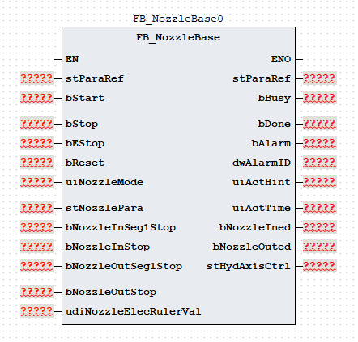
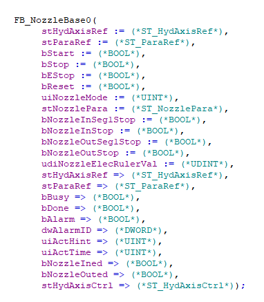

# 《FB_NozzleBase 功能块使用说明》

| 项目 | 内容 |
|---|---|
| 模块名称 | `FB_NozzleBase` |
| 适用场景 | 注塑机座台进、座台退的最多两段工艺控制 |
| 版本信息 | 文档版本 1.1；库版本  `PlasticLibs` 1.0.26.908；更新日期 2026-09-10 |
| 依赖库信息 | `HydTechnology` 0.1.1.0，提供 `FB_HydAxis`、`ST_HydAxisRef` 等液压轴相关类型和功能块|
| 事实原则 | 以下描述以当前 ST 执行逻辑为准；注释与实际逻辑不一致时标注“需协议确认” | 

## 1. 功能概述

### 功能职责

`FB_NozzleBase` 组织座台进、座台退的启动、分段执行、结束、完成及错误流程，将座台工艺参数转换为 `stHydAxisCtrl` 轴命令，并输出动作状态、完成状态和报警结果。功能块支持：

- 座台进和座台退，每个方向最多执行 2 段；
- 普通模式和调模模式下的座台进、座台退；
- 时间、数字停止反馈和电子尺位置三种实际结束方式；
- 分段压力、速度、位置、结束速度及斜率命令；
- 座台进完成、座台退完成、动作提示、报警状态和报警代码输出。

### 输入与输出

| 调用者提供 | 功能块输出 |
|---|---|
| `bStart`、`bStop`、`bEStop`、`bReset`、`uiNozzleMode` | `bBusy`、`bDone`、`bAlarm`、`dwAlarmID` |
| `stNozzlePara`、`stParaRef` | `uiActHint`、`uiActTime`、`bNozzleIned`、`bNozzleOuted` |
| `stHydAxisRef`、座台进/退停止信号、`udiNozzleElecRulerVal` | `stHydAxisCtrl` 轴命令和轴状态包；`stHydAxisRef` 调用后回写 |

### 主要执行流程

~~~text
读取 uiNozzleMode，确定普通/调模标志及座台进/退方向
  -> 按优先级处理复位、急停和正常停止（含 bStart 下降沿）
  -> Idle 接收 bStart 上升沿后进入 Init
  -> Init 归一化段数、设置轴方向，进入座台进或座台退
  -> 每段累计时间，按时间、数字停止或电子尺位置判断是否切换下一段
  -> 当前下标超过允许范围时进入对应完成状态；达到总限时或发生错误时进入 Error
  -> 每次调用末尾执行内部 FB_HydAxis，并将轴命令和轴状态转存到 stHydAxisCtrl
~~~

### 功能边界

本功能块生成座台工艺状态和轴命令，并在当前固定 `IF TRUE` 分支内调用内部 `FB_HydAxis`；不直接访问通信报文、全局变量、`%I/%Q` 或物理 I/O，不替代轴闭环、独立急停、安全联锁、机械限位、轴故障处理或物理能量切断。`FB_EleAxis` 分支虽然保留在 ST 中，但当前条件下不会执行；电动轴接入需要依据实际 POU 和轴库接口另行核对。

## 2. 自定义数据类型

### 2.1 `E_NozzleState`

| 枚举成员 | 用途 |
|---|---|
| `eNozzleState_Idle` | 空闲 |
| `eNozzleState_Init` | 初始化 |
| `eNozzleState_NozzleIning` | 座台进 |
| `eNozzleState_NozzleIned` | 座台进完成 |
| `eNozzleState_NozzleOuting` | 座台退 |
| `eNozzleState_NozzleOuted` | 座台退完成 |
| `eNozzleState_Error` | 错误 |

### 2.2 `ST_NozzleSeg`

| 成员 | 类型 | 读写属性 | 用途 |
|---|---|---|---|
| `uiPres` | `UINT` | 只读 | 压力命令 |
| `uiSpd` | `UINT` | 只读 | 速度命令 |
| `udiPos` | `UDINT` | 只读 | 位置目标 |
| `uiTime` | `UINT` | 只读 | 时间阈值 |
| `uiPresGrad` | `UINT` | 只读 | 压力斜率；普通模式用于相邻段加减速参数 |
| `uiSpdGrad` | `UINT` | 只读 | 速度斜率；普通模式用于相邻段加减速参数 |

### 2.3 `ST_NozzlePara`

| 成员 | 类型 | 读写属性 | 用途 |
|---|---|---|---|
| `uiAutoNozzleRetract` | `UINT` | 只读 | 自动座退选择 |
| `uiNozzleInSegCnt` | `UINT` | 只读 | 座台进段数选择；收口到 `0..1` |
| `uiNozzleInMode` | `UINT` | 只读 | 座台进方式：`0` 时间、`1` 行程、`2` 位置 |
| `uiNozzleInLimitTime` | `UINT` | 只读 | 座台进总时限 |
| `aNozzleInSeg` | `ARRAY[0..1] OF ST_NozzleSeg` | 只读 | 座台进分段参数 |
| `stNozzleInDebug` | `ST_NozzleSeg` | 只读 | 座台进调模参数 |
| `uiNozzleInDebugPresStartGrad` | `UINT` | 只读 | 座台进调模压力启动斜率 |
| `uiNozzleInDebugPresStopGrad` | `UINT` | 只读 | 座台进调模压力停止斜率 |
| `uiNozzleInDebugSpdStartGrad` | `UINT` | 只读 | 座台进调模速度启动斜率 |
| `uiNozzleInDebugSpdStopGrad` | `UINT` | 只读 | 座台进调模速度停止斜率 |
| `uiNozzleInPresStartGrad` | `UINT` | 只读 | 座台进压力启动斜率 |
| `uiNozzleInPresStopGrad` | `UINT` | 只读 | 座台进压力停止斜率 |
| `uiNozzleInSpdStartGrad` | `UINT` | 只读 | 座台进速度启动斜率 |
| `uiNozzleInSpdStopGrad` | `UINT` | 只读 | 座台进速度停止斜率 |
| `uiNozzleOutSegCnt` | `UINT` | 只读 | 座台退段数选择；收口到 `0..1` |
| `uiNozzleOutMode` | `UINT` | 只读 | 座台退方式：`0` 时间、`1` 行程、`2` 位置 |
| `uiNozzleOutLimitTime` | `UINT` | 只读 | 座台退总时限 |
| `aNozzleOutSeg` | `ARRAY[0..1] OF ST_NozzleSeg` | 只读 | 座台退分段参数 |
| `stNozzleOutDebug` | `ST_NozzleSeg` | 只读 | 座台退调模参数 |
| `uiNozzleOutDebugPresStartGrad` | `UINT` | 只读 | 座台退调模压力启动斜率 |
| `uiNozzleOutDebugPresStopGrad` | `UINT` | 只读 | 座台退调模压力停止斜率 |
| `uiNozzleOutDebugSpdStartGrad` | `UINT` | 只读 | 座台退调模速度启动斜率 |
| `uiNozzleOutDebugSpdStopGrad` | `UINT` | 只读 | 座台退调模速度停止斜率 |
| `uiNozzleOutPresStartGrad` | `UINT` | 只读 | 座台退压力启动斜率 |
| `uiNozzleOutPresStopGrad` | `UINT` | 只读 | 座台退压力停止斜率 |
| `uiNozzleOutSpdStartGrad` | `UINT` | 只读 | 座台退速度启动斜率 |
| `uiNozzleOutSpdStopGrad` | `UINT` | 只读 | 座台退速度停止斜率 |

### 2.4 `ST_ParaRef`

| 成员 | 类型 | 读写属性 | 用途 |
|---|---|---|---|
| `udiPosToleranceValue` | `UDINT` | 读写 | 位置容差值 |

### 2.5 `ST_HydAxisRef`

该类型由液压轴库定义。本功能块将 `stHydAxisRef` 传入内部 `FB_HydAxis`，调用后再回写；结构成员请查阅 HydTechnology 技术库使用说明书。

### 2.6 `ST_HydAxisCtrl`

| 成员 | 类型 | 读写属性 | 用途 |
|---|---|---|---|
| `bAxisStart` | `BOOL` | 只写 | 轴启动信号 |
| `uiAxisDir` | `UINT` | 只写 | 轴方向；座台进写 `1`，座台退写 `2` |
| `uiAxisMode` | `UINT` | 只写 | 轴控制模式：`1` 位置、`2` 速度、`3` 压力 |
| `uiPresCmd` | `UINT` | 只写 | 压力命令 |
| `uiSpdCmd` | `UINT` | 只写 | 速度命令 |
| `uiEndSpdCmd` | `UINT` | 只写 | 结束速度 |
| `udiPosCmd` | `UDINT` | 只写 | 位置命令 |
| `uiAxisPresAcc` | `UINT` | 只写 | 压力加速度参数 |
| `uiAxisPresDec` | `UINT` | 只写 | 压力减速度参数 |
| `uiAxisSpdAcc` | `UINT` | 只写 | 速度加速度参数 |
| `uiAxisSpdDec` | `UINT` | 只写 | 速度减速度参数 |
| `uiAxisJerk` | `UINT` | 只写 | 加加速度参数 |
| `bBusy` | `BOOL` | 内部轴功能块写入 | 液压轴忙状态 |
| `bDone` | `BOOL` | 内部轴功能块写入 | 液压轴完成状态 |
| `bInVelocity` | `BOOL` | 内部轴功能块写入 | 液压轴速度到位状态 |
| `bInPressure` | `BOOL` | 内部轴功能块写入 | 液压轴压力到位状态 |
| `bAlarm` | `BOOL` | 内部轴功能块写入 | 液压轴报警状态 |
| `dwAlarmID` | `DWORD` | 内部轴功能块写入 | 液压轴报警代码 |

## 3. 功能块接口

### 3.1 `VAR_IN_OUT`

| 名称 | 类型 | 当前行为 | 信号含义 |
|---|---|---|---|
| `stHydAxisRef` | `ST_HydAxisRef` | 传入内部 `FB_HydAxis`，调用后回写 | 液压轴参数引用参考 |
| `stParaRef` | `ST_ParaRef` | 引用位置容差值 | 工艺参数引用参考 |

### 3.2 `VAR_INPUT`

| 名称 | 类型 | 当前行为 | 信号含义 |
|---|---|---|---|
| `bStart` | `BOOL` | 在 `Idle` 中检测上升沿后进入初始化；下降沿触发正常停止 | 启动命令 |
| `bStop` | `BOOL` | 优先级低于复位和急停；回到空闲并清主要轴命令和计时 | 正常停止 |
| `bEStop` | `BOOL` | 进入错误状态并按位加入 `16#0001` | 急停请求 |
| `bReset` | `BOOL` | 最高优先级；清状态、报警、主要轴命令和计时并回到空闲 | 复位命令 |
| `uiNozzleMode` | `UINT` | `1` 普通座台进，`2` 普通座台退，`3` 座台进调模，`4` 座台退调模；其他值在 `Init` 报警 | 座台动作模式 |
| `stNozzlePara` | `ST_NozzlePara` | 按周期读取段数、结束方式、分段命令、调模命令和斜率 | 座台工艺参数 |
| `bNozzleInSeg1Stop` | `BOOL` | 座台进结束方式为 `1` 且当前为第 0 段时参与结束判断 | 座台进第 1 段停止反馈 |
| `bNozzleInStop` | `BOOL` | 座台进结束方式为 `1` 时参与所有分段结束判断 | 座台进停止反馈 |
| `bNozzleOutSeg1Stop` | `BOOL` | 座台退结束方式为 `1` 且当前为第 0 段时参与结束判断 | 座台退第 1 段停止反馈 |
| `bNozzleOutStop` | `BOOL` | 座台退结束方式为 `1` 时参与所有分段结束判断 | 座台退停止反馈 |
| `udiNozzleElecRulerVal` | `UDINT` | 座台进位置方式使用 `>=` 比较，座台退位置方式使用 `<=` 比较 | 座台电子尺位置反馈 |

### 3.3 `VAR_OUTPUT`

| 名称 | 类型 | 当前行为 | 信号含义 |
|---|---|---|---|
| `bBusy` | `BOOL` | `bStart` 上升沿启动后置位；停止、完成、急停或错误状态清除 | 工艺忙状态 |
| `bDone` | `BOOL` | 座台进或座台退完成状态中置位并保持；清状态时清除 | 工艺完成状态 |
| `bAlarm` | `BOOL` | 无效模式、急停或错误状态置位；仅复位明确清除，停止、完成和空闲不自动清除 | 工艺报警状态 |
| `dwAlarmID` | `DWORD` | 报警代码按位 OR 累积；仅复位清零，其他分支不自动清除 | 工艺报警代码 |
| `uiActHint` | `UINT` | 输出空闲、报警、座台进/退分段或对应完成提示 | 当前动作提示 |
| `uiActTime` | `UINT` | 输出当前阶段累计调用值；清状态时置 `0` | 当前动作运行时间 |
| `bNozzleIned` | `BOOL` | 座台进完成状态中置位；停止、急停、错误和复位清除 | 座台进完成 |
| `bNozzleOuted` | `BOOL` | 座台退完成状态中置位；停止、急停、错误和复位清除 | 座台退完成 |
| `stHydAxisCtrl` | `ST_HydAxisCtrl` | 每次调用末尾转存本地轴命令和内部 `FB_HydAxis` 状态 | 轴命令和轴状态包 |

`stHydAxisCtrl.bBusy`、`bDone`、`bInVelocity`、`bInPressure`、`bAlarm` 和 `dwAlarmID` 来自内部 `FB_HydAxis`，与本功能块自身的 `bBusy`、`bDone`、`bAlarm` 和 `dwAlarmID` 分属不同层级，外部读取和汇总时不得直接互换。

## 4. 报警和状态码

### 4.1 报警代码与报警信息

| 报警代码 | 报警信息 |
|---|---|
| `16#0000` | 无报警 |
| `16#0001` | 紧急停止 |
| `16#0002` | `uiNozzleMode` 参数无效 |
| `16#0004` | 座台进总限时报警 |
| `16#0008` | 座台退总限时报警 |

### 4.2 动作状态码

| `uiActHint` | 含义 |
|---:|---|
| `0` | 无动作 |
| `1` | 报警状态 |
| `2` | 座台进完成 |
| `3` | 座台退完成 |
| `11..12` | 座台进第 1～2 段 |
| `21..22` | 座台退第 1～2 段 |

## 5. 调用规范和注意事项

1. **固定周期调用和计时。** 在稳定、已知周期内每周期调用一次，并在调用前刷新模式、工艺参数、停止反馈和电子尺位置。当前工程任务周期为 `T#1ms`；活动阶段每次调用将阶段计时和总计时各增加 `1`，当前段时间和座台进/退总限时都按参数值乘 `100` 次调用比较，分段结束后阶段计时清零而总计时继续累加，`uiActTime` 为当前段累计调用值，实际时间取决于调用周期。
2. **调用顺序和轴层边界。** 先准备 `stHydAxisRef`、`stParaRef`、`stNozzlePara`、`uiNozzleMode`、停止反馈和电子尺位置，再调用 `FB_NozzleBase`，最后读取 `stHydAxisCtrl`、动作输出和回写后的 `stHydAxisRef`。当前 POU 每次调用末尾已执行内部 `FB_HydAxis`，调用者不应为同一动作重复调用外部轴功能块。
3. **模式、段数和结束条件。** `uiNozzleMode` 只允许 `1` 普通座台进、`2` 普通座台退、`3` 座台进调模或 `4` 座台退调模；活动过程中改变该值不会切换已进入的状态。段数初始化时按 `0/1` 输入得到内部最后下标 `0`，按 `2` 及以上输入得到内部最后下标 `1`；没有独立段数报警，输入 `0` 仍可能执行第 0 段。`uiNozzleInMode`/`uiNozzleOutMode` 只有 `0`（时间）、`1`（数字停止）和 `2`（位置）有实际分支，其他值没有独立报警，可能只能等待总限时；总限时为 `0` 时禁用。
4. **位置容差、调模参数和未使用字段。** 位置方式下，座台进用 `udiNozzleElecRulerVal + stParaRef.udiPosToleranceValue >= 当前段位置`，座台退用 `udiNozzleElecRulerVal <= 当前段位置 + stParaRef.udiPosToleranceValue`；容差仅参与这两类判断。调模模式只替换压力、速度、位置和调模斜率命令源，结束方式、段数、时间和结束位置判断仍取普通分段字段。`uiAutoNozzleRetract`、四个普通模式停止斜率字段，以及调模结构的 `uiTime`、`uiPresGrad`、`uiSpdGrad` 当前未读取。
5. **启动、停止、急停、复位和分段清零。** 处理优先级为 `bReset` > `bEStop` > (`bStop` 或 `bStart` 下降沿) > 状态机。`bStart` 上升沿只在 `Idle` 中启动；正常停止回到 `Idle`，清主要轴命令、阶段/总计时和两个方向完成输出，但不自动清 `bAlarm` 或 `dwAlarmID`。急停清主要状态并进入错误态、置 `16#0001`；复位清报警并回到空闲。每段结束时仅将 `uiStageIndex` 加 `1`、将阶段计时清 `0`，随后再判断是否完成；急停输入保持有效时，复位后的下一次调用仍会重新进入急停分支。
6. **轴命令、启动信号和安全边界。** 当前固定分支只调用 `FB_HydAxis`，座台进写 `uiAxisDir=1`、座台退写 `uiAxisDir=2`；位置方式写 `uiAxisMode=1`，时间/数字停止方式写 `uiAxisMode=2`。`bAxisStart` 仅在阶段计时大于 `2` 且小于 `20` 时被明确置 `TRUE`；位置方式在其他非结束扫描明确置 `FALSE`，时间/数字停止方式在其他时刻不赋值并保持此前缓存。速度斜率传给内部轴的 `uiAcc`/`uiDec`，压力斜率只转存到 `stHydAxisCtrl`；`uiEndSpdCmd`、`udiPosCmd` 按普通/调模命令源赋值，`uiAxisJerk` 没有有效工艺来源。轴层状态与工艺层状态应分层读取；本功能块不替代独立急停、安全门/光幕、座台互锁、机械限位、轴故障处理或物理能量切断。

## 6. 外部交互边界

| 方向 | 交互对象 | 数据边界 |
|---|---|---|
| 输入 | HMI、配方和上层工艺逻辑 | `uiNozzleMode`、`stNozzlePara`、`stParaRef`、启动/停止/急停/复位命令 |
| 输入 | 现场信号转换层 | `bNozzleInSeg1Stop`、`bNozzleInStop`、`bNozzleOutSeg1Stop`、`bNozzleOutStop`、`udiNozzleElecRulerVal` |
| 输入/输出 | `stHydAxisRef` | 传入内部 `FB_HydAxis`，调用后回写液压轴配置和反馈结构 |
| 内部调用 | `FB_HydAxis` | 接收本功能块生成的启停/急停/复位、方向、模式、压力、速度、结束速度、位置、速度斜率和加加速度命令，并将轴状态转存到 `stHydAxisCtrl` |
| 保留分支 | `FB_EleAxis` | 当前固定 `IF TRUE` 分支不会执行，切换电动轴前需修改并核对实际接口 |
| 输出 | HMI、诊断和报警逻辑 | `bBusy`、`bDone`、`bNozzleIned`、`bNozzleOuted`、`uiActHint`、`uiActTime`、功能块报警及轴报警 |

当前 ST 不直接访问通信报文、全局变量、`%I/%Q` 或物理 I/O。功能块报警和轴报警是两层输出，外部逻辑应按系统报警策略分别读取并汇总。

## 7. 最小调用示例

以下示例使用通用占位符，工程师需将其替换为真实对象。上层逻辑先准备模式、座台参数、停止反馈和电子尺位置，再调用本功能块；轴功能块已在本功能块内部调用，示例不重复调用外部轴功能块。

### 7.1 调用座台功能块

~~~ST
(* 上层逻辑先准备 uiNozzleMode、stNozzlePara 和座台反馈输入。 *)

fbExample(
    stHydAxisRef := stHydAxisRef,
    stParaRef := stParaRef,
    bStart := bStart,
    bStop := bStop,
    bEStop := bEStop,
    bReset := bReset,
    uiNozzleMode := uiNozzleMode,
    stNozzlePara := stNozzlePara,
    bNozzleInSeg1Stop := bNozzleInSeg1Stop,
    bNozzleInStop := bNozzleInStop,
    bNozzleOutSeg1Stop := bNozzleOutSeg1Stop,
    bNozzleOutStop := bNozzleOutStop,
    udiNozzleElecRulerVal := udiNozzleElecRulerVal,
    bBusy => bNozzleBusy,
    bDone => bNozzleDone,
    bAlarm => bNozzleProcessAlarm,
    dwAlarmID => dwNozzleAlarmID,
    uiActHint => uiNozzleActHint,
    uiActTime => uiNozzleActTime,
    bNozzleIned => bNozzleIned,
    bNozzleOuted => bNozzleOuted,
    stHydAxisCtrl => stNozzleHydAxisCtrl
);

(* 工艺层报警与内部液压轴报警分层读取。 *)
bHydAxisAlarm := stNozzleHydAxisCtrl.bAlarm;
dwHydAxisAlarmID := stNozzleHydAxisCtrl.dwAlarmID;
~~~
